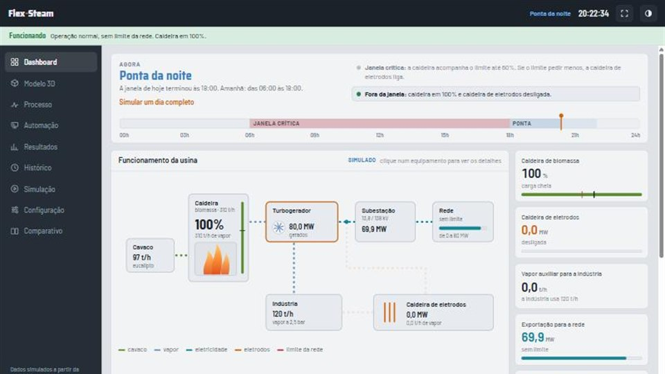
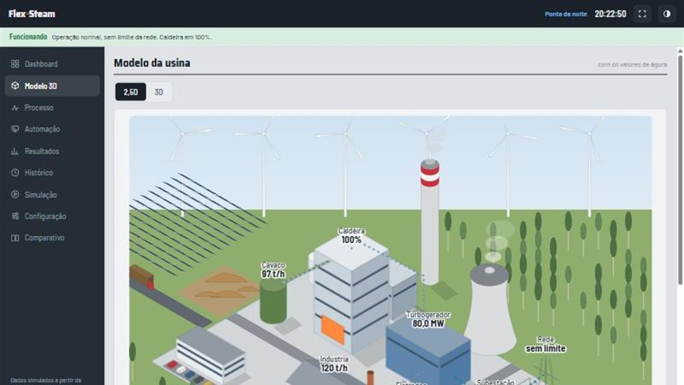
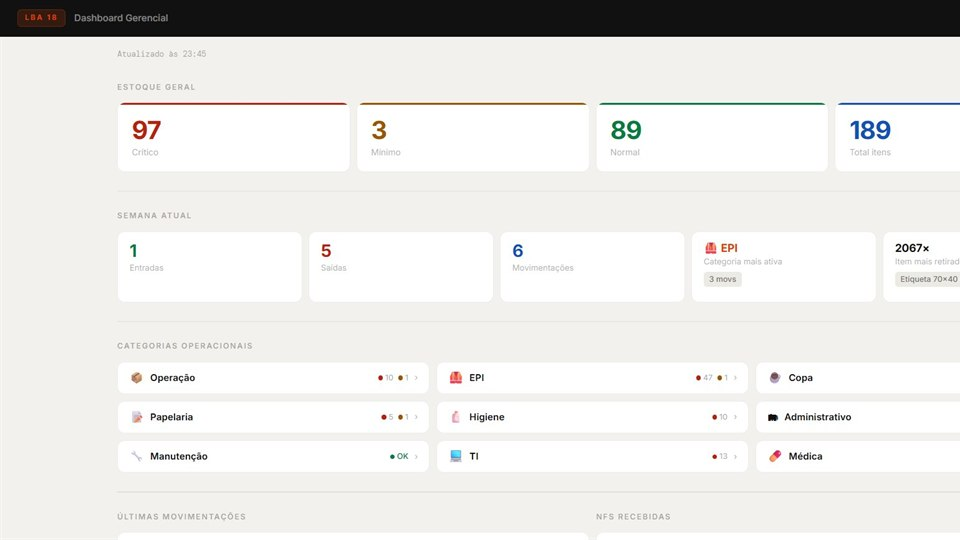
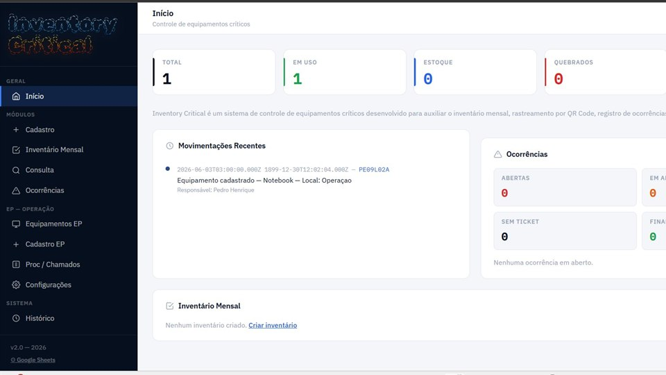
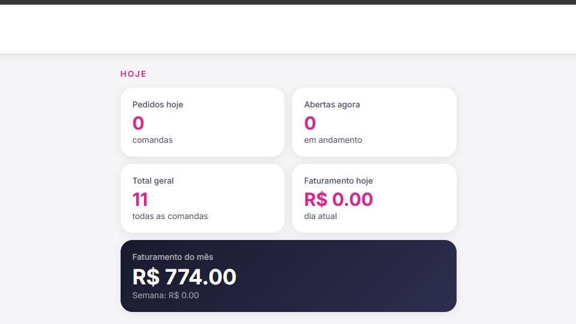
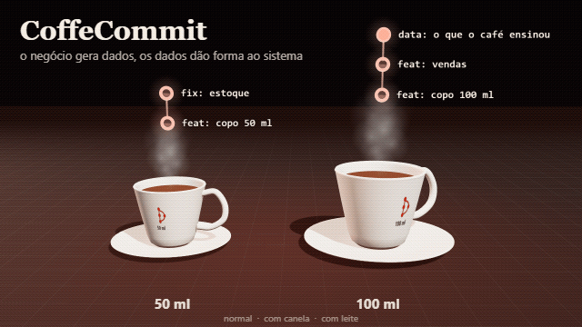
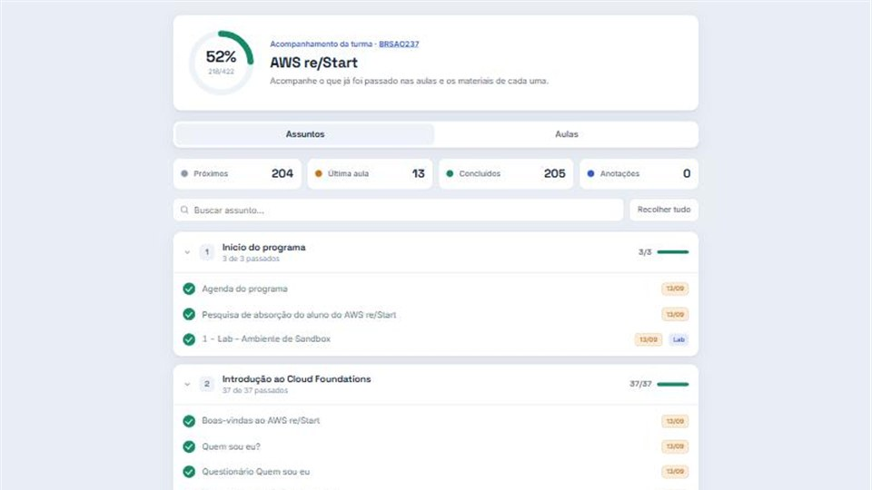

 

## 👋 Sobre

Estudante do Técnico em Desenvolvimento de Sistemas no **SENAI CIMATEC** e do programa **AWS re/Start**, em Salvador. Transformo problemas reais em sistemas simples que funcionam. Hoje o meu foco é **Java, Spring Boot e nuvem com AWS**, e busco **estágio ou vaga júnior**.

> "O óbvio precisa ser dito."

## 🛠️ Tecnologias

<table>
<tr><th colspan="5">Linguagens</th></tr>
<tr>
<td align="center" width="96"> Java</td>
<td align="center" width="96"> JavaScript</td>
<td align="center" width="96"> C++</td>
<td align="center" width="96"> HTML</td>
<td align="center" width="96"> CSS</td>
</tr>
</table>

<table>
<tr><th colspan="2">Back-end e dados</th></tr>
<tr>
<td align="center" width="96"> Spring Boot</td>
<td align="center" width="96"> MySQL</td>
</tr>
</table>

<table>
<tr><th colspan="8">Nuvem e ferramentas</th></tr>
<tr>
<td align="center" width="96"> AWS</td>
<td align="center" width="96"> Docker</td>
<td align="center" width="96"> Git</td>
<td align="center" width="96"> GitHub</td>
<td align="center" width="96"> IntelliJ</td>
<td align="center" width="96"> VS Code</td>
<td align="center" width="96"> Netlify</td>
<td align="center" width="96"> Vercel</td>
</tr>
</table>

## 🚀 Projetos em destaque

<table>
<tr>
<td colspan="2" valign="top">

<h3>Flex-Steam</h3>

Protótipo do <b>Grand Prix SENAI CIMATEC 2026</b>, para o desafio da Altus Sistemas de Automação: uma usina de biomassa que sofre cortes de exportação da rede. Simula um dia da usina com e sem o Flex-Steam e mostra o processo, a automação, os resultados e o comparativo, com modelo da usina em 2,5D e 3D. Funciona no computador e no celular. Dados simulados a partir da ficha do desafio.

<a href="https://flexsteam.vercel.app"><b>Ver no ar →</b></a>

</td>
</tr>
<tr>
<td width="50%" valign="top">

<h3>Almoxarifado</h3>

Controle de entradas e saídas de materiais: 202 itens em 9 categorias e alerta automático de estoque crítico. Criado para acabar com o controle manual, que gerava erros e retrabalho. Foi adotado por outras bases da regional.

<a href="https://my-names-is.netlify.app/"><b>Ver no portfólio →</b></a>

</td>
<td width="50%" valign="top">

<h3>Inventory Critical</h3>

Controle de equipamentos críticos de TI e de operação: cada item tem foto e QR code para agilizar o inventário mensal, e as ocorrências e chamados ficam reunidos no mesmo lugar, antes espalhados em planilhas.

<a href="https://inventory-critical.netlify.app/"><b>Ver no ar →</b></a>

</td>
</tr>
<tr>
<td width="50%" valign="top">

<h3>Psiu Tab</h3>

Comandas digitais para food trucks e pequenos negócios: abrir mesas, registrar pedidos e fechar contas de forma simples, pensado para quem não tem experiência com tecnologia.

</td>
<td width="50%" valign="top">

<h3>CoffeCommit</h3>

Uma mini operação <b>real</b> de venda de café, montada com um amigo como laboratório de programação e de dados: o estoque fica em duas casas, o café é feito em litros e vendido em mililitros. O negócio gera dados, e os dados dão forma ao sistema.

<a href="https://github.com/pedrohfilho/CoffeCommit"><b>Ver o código →</b></a>

</td>
</tr>
<tr>
<td width="50%" valign="top">

<h3>AWS re/Start: acompanhamento da turma</h3>

Mapa do andamento das aulas e caderno compartilhado da turma, para reunir num lugar só os links e as anotações que se perdem no meio das conversas.

<a href="https://aws-re-start.vercel.app"><b>Ver no ar →</b></a> &nbsp;·&nbsp; <a href="https://github.com/pedrohfilho/AWS-re-Start"><b>Código →</b></a>

</td>
<td width="50%" valign="top">
<h3>Controle Financeiro</h3>

Sistema de controle financeiro pessoal para celular e computador: registra entradas, gastos fixos e variáveis e investimentos, lembra das contas do mês e mostra o saldo com histórico e filtros. As abas de uma planilha fazem o papel de banco de dados.

<a href="https://github.com/pedrohfilho/sistema-de-controle-financeiro"><b>Ver o código →</b></a>

</td>
</tr>
</table>

## 🎯 Agora

- Cursando o **AWS re/Start** (ago a dez/2026): Linux, Python e Shell, e os serviços principais da AWS
- Desenvolvendo o **PetLink**, o meu TCC em grupo: uma plataforma que conecta tutores de pets a prestadores de serviço
- Voluntário de TI na **ABEMSA**, mantendo o site da associação de moradores do Sete de Abril

## 🏆 Eventos e competições

- **Grand Prix SENAI CIMATEC 2026**: protótipo Flex-Steam, em equipe multidisciplinar
- **SEMCOMP 2026** e **Power Tech Hackathon**: a minha primeira maratona de programação
- **SIINTEC 2026**
- **AWS Community Day Nordeste 2026**: voluntário

 
Feito em Salvador, BA

